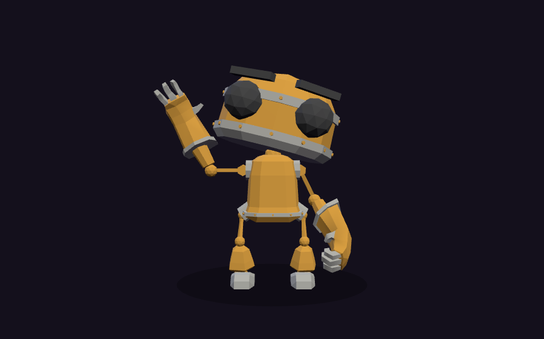

# Gesture Harness

Give your LLM some body language. Gesture Harness is a small [MCP](https://modelcontextprotocol.io) server that lets Claude, Codex, Cursor or any other MCP client play the gestures of an animated 3D character: a wave hello, a nod, a thumbs-up, a dance when something works. The character appears in a browser page you keep open, on your screen or on a spare phone or tablet beside it.

It comes with a robot to try. To use your own character, point it at any `.glb` file that has animations: every animation clip in the file becomes a gesture the LLM can ask for, and any facial morph targets become expressions. Nothing needs to be configured for a new model.



## What you need

- **Node.js 18 or newer.** There is nothing to install beyond the repository.
- **An MCP client**, such as Claude Desktop, Claude Code, Codex or Cursor.
- **A browser** to show the character. The page loads three.js from a CDN, so the browser needs to be online.
- **Optionally, your own character**: a binary glTF (`.glb`) with named animation clips. Without one you get the bundled robot.

The character is an animation on screen. Nothing physical moves.

## Try it

```sh
git clone https://github.com/DanP20/gesture-harness.git
```

Add it to your MCP client, using the full path to `src/server.js`:

**Claude Code**

```sh
claude mcp add gestures -- node /full/path/to/gesture-harness/src/server.js
```

**Claude Desktop** (Settings, Developer, Edit Config) or **Cursor** (`~/.cursor/mcp.json`)

```json
{
  "mcpServers": {
    "gestures": { "command": "node", "args": ["/full/path/to/gesture-harness/src/server.js"] }
  }
}
```

**Codex** (`~/.codex/config.toml`)

```toml
[mcp_servers.gestures]
command = "node"
args = ["/full/path/to/gesture-harness/src/server.js"]
```

Restart the client, open **http://localhost:7444** in a browser, and ask: *"Make the robot wave."*

To see a model's gestures without an LLM, run `node src/server.js --serve` and open http://localhost:7444/?buttons. It shows a button for each gesture and expression.

## What the LLM gets

| Tool | What it does |
|---|---|
| `list_gestures` | The gestures and how long each one lasts, the expressions, and whether anyone has the viewer open |
| `play_gesture` | Plays one gesture, `times` in a row (1 to 5), then returns to idle. The call returns when the gesture has finished, so a run of calls plays them in order. |
| `set_expression` | Sets a facial expression for a few seconds (`amount` 0 to 1, `seconds` 0 to 30). Only offered if the model has expressions. |

The tool descriptions name the gestures and suggest using them sparingly, when they fit what is being said. If nobody has the viewer open, a call fails with a message telling the LLM where the viewer is.

## Bring your own character

```sh
node src/server.js --model ~/models/fox.glb --name "the fox"
```

The model needs to be a `.glb` with its animation clips named the way you want the LLM to see them, such as `Wave` or `Dance`. Some places to find or make one:

- **[Quaternius](https://quaternius.com)**: free (CC0) animated characters. The bundled robot is one of them.
- **[Mixamo](https://www.mixamo.com)**: pick a character and some animations, then combine them into a single `.glb` in Blender, with one action per gesture.
- **Your own rig**, exported from Blender as glTF Binary with animations included.

The clip with "idle" in its name loops between gestures. Use `--idle` to pick a different one, and `--gestures Wave,Nod,Dance` to offer only some of the clips. Morph targets (shape keys) named in the file, like `Smile` or `Angry`, become expressions.

## Options

| Flag | Environment variable | Default | |
|---|---|---|---|
| `--model` | `GESTURE_MODEL` | the bundled robot | the `.glb` to show |
| `--name` | `GESTURE_NAME` | "the robot" | what the LLM is told the character is called |
| `--idle` | `GESTURE_IDLE` | the first clip with "idle" in its name | the clip that loops between gestures |
| `--gestures` | `GESTURE_LIST` | every clip except the idle one | a comma-separated list of clips to offer |
| `--port` | `GESTURE_PORT` | 7444 | where the viewer is served |
| `--host` | `GESTURE_HOST` | 127.0.0.1 | `0.0.0.0` lets a phone or tablet on your network show the character. Anyone else on that network could then open it and play gestures, so only do this on a network you trust. |
| `--serve` | | | keep running without an MCP client |

For the bundled robot, the default list leaves out its Death, Sitting and Standing clips.

The viewer page has its own options in the address:

- `?bg=transparent`: no background, for OBS and other streaming tools.
- `?bg=ffffff`: any background colour, as a hex code.
- `?clean`: hides the line of text.
- `?buttons`: shows the try-it buttons.

## How it works

```
MCP client ──stdio──▶ gesture-harness ──server-sent events──▶ viewer page (three.js)
                      reads the clips and expressions           plays the clip, then
                      straight from the .glb                    fades back to idle
```

The MCP client starts the harness. The harness reads the clip names, their lengths and the morph targets from the `.glb`, and serves the viewer and the model on localhost. When a gesture is called, it tells every open viewer to play it, then waits for the clip's length before it answers.

You might have two MCP clients open at once, say Claude Desktop and Codex. The first copy holds the port, and the second passes its requests to the first, so both clients drive the same character.

It uses no npm packages: one Node file for the server, and one page for the viewer.

## Where it came from

This began as gestures for a robot on a little round desk screen that sat beside an AI voice chat. Asked to wave or celebrate, the robot did it. Gesture Harness is the general version: any character, any MCP client, any screen with a browser.

## Credits

The bundled robot is [RobotExpressive](https://github.com/mrdoob/three.js/tree/dev/examples/models/gltf/RobotExpressive), modelled by [Tomás Laulhé (Quaternius)](https://quaternius.com) and released CC0 1.0. Don McCurdy added the facial expressions and converted it for three.js. The viewer uses [three.js](https://threejs.org) (MIT).

## Licence

MIT. See [LICENSE](LICENSE).
